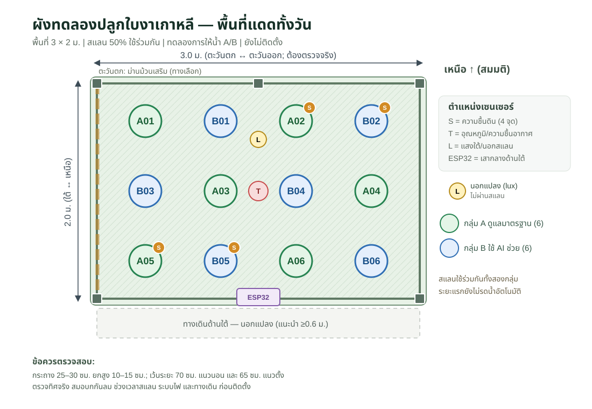

# Site Layout — 12 pots / 3.0 × 2.0 m

Updated: 2026-11-05 | Version: v0.4 | Physical installation pending site survey

## Coordinate convention

- X from **west to east**, 0.0–3.0 m; Y from **south to north**, 0.0–2.0 m.
- This is a drawing convention, **not verified property orientation**. Rotate entire drawing to match the real garden / sun path after field survey.
- South edge shown as **front access**. Walkway outside frame ≥0.6 m where reachable.
- For 0.6 m clearance on all 4 sides, overall unobstructed area ≈ **4.2 × 3.2 m**.
- Pot centers X = 0.45, 1.15, 1.85, 2.55 m (pitch 0.70 m); Y = 0.35, 1.00, 1.65 m (pitch 0.65 m).
- Pots ~25–30 cm diameter; elevate 10–15 cm above turf on stable blocks/feet; ensure drain holes free.
- 70 cm centers are acceptable for an **early-stage pot trial**; if adult foliage crowds, widen plot or harvest/relocate *both arms equally* and document it.

## Top view (schematic, fixed 4-column grid)

~~~text
                      WEST --> EAST (X)
             x=.45       1.15       1.85       2.55
NORTH y=1.65  A01        B01        A02*       B02*
       y=1.00  B03        A03        B04        A04
SOUTH y=0.35  A05*       B05*       A06        B06
                 * = soil moisture probe (4)
                 T/RH near x=1.50, y=1.00
                 LUX-IN x=1.50, y=1.48
                 ESP32 at south-mid post
~~~

The [SVG drawing](site-layout.svg) shows dimensions, poles, side curtain, and out-of-plot light sensor.

## Exact pot coordinates (metres)

| Pot ID | Arm | X | Y | Soil probe |
|---|---|---:|---:|---|
| A01 | Control | 0.45 | 1.65 | no |
| B01 | AI | 1.15 | 1.65 | no |
| A02 | Control | 1.85 | 1.65 | S-A02 |
| B02 | AI | 2.55 | 1.65 | S-B02 |
| B03 | AI | 0.45 | 1.00 | no |
| A03 | Control | 1.15 | 1.00 | no |
| B04 | AI | 1.85 | 1.00 | no |
| A04 | Control | 2.55 | 1.00 | no |
| A05 | Control | 0.45 | 0.35 | S-A05 |
| B05 | AI | 1.15 | 0.35 | S-B05 |
| A06 | Control | 1.85 | 0.35 | no |
| B06 | AI | 2.55 | 0.35 | no |

* = 1 soil probe. Two probes per arm, one north/south and one edge/interior representative. All other pots need periodic manual check. The A/B labels are starting assignments; ideally perform matched randomization after the seedlings are comparable.

## Frame and shade

- 6 poles: (X,Y) = (0,0), (1.5,0), (3,0), (0,2), (1.5,2), (3,2).
- Target clear headroom ≥1.8 m, with top ~1.9–2.1 m based on user's reach/structure.
- Choose 50% shade cloth with **quick-release clips / roll-up top**; use between ~10:30–15:30 initially when sunny and plants show heat load. Time is a provisional observation rule, not universal.
- Sides open for airflow. Optional **western roll-up curtain** if low-angle afternoon sun still reaches leaves, activated identically for all 12 pots.
- Shade mesh **does not keep rain out**. Do not rely on roof slope to control rain in pots.
- Anchor the pole bases to ground using verified soil-appropriate methods with bracing; removal in high wind is mandatory. PVC-only tall frames are not the default recommendation.
- Never assume a 3×2 m wind-loaded canopy is structurally safe without testing its bracing and anchoring.

## Sensor locations

| ID | Proposed location | Mount / caution |
|---|---|---|
| T/RH-01 | (1.50,1.00), roughly at canopy height | SHT31 inside ventilated radiation shield; do not let leaves/shade touch it |
| LUX-IN | (1.50,1.48), top-of-canopy | BH1750 in weather-protected *light-transparent* enclosure; avoid self-shading |
| LUX-OUT | outside frame, near (3.35,1.00) | compare unshaded vs shaded readings; check device range and saturation |
| S-A02 | A02 pot at (1.85,1.65) | halfway between stem and pot edge at similar depth |
| S-B02 | B02 pot at (2.55,1.65) | same |
| S-A05 | A05 pot at (0.45,0.35) | same |
| S-B05 | B05 pot at (1.15,0.35) | same |
| MCU-01 | South-mid post (1.50,0.00), 1.2–1.5 m height | ESP32 inside IP65 enclosure; cable glands face downward; drip loops; accessible away from spray |
| PHOTO | Fixed smartphone position outside south edge | Photo each pot with pot ID and fixed scale marker; same light/time when feasible |

**Important electrical detail:** Long analog soil-sensor cables create noise. Keep leads short/shielded (start ≤2 m practical routing), validate ADC stability; if runs are longer, use local ADC/second ESP32 or digital/RS485 probes (not included in base budget).

## Installation cross-section

~~~text
    1.9–2.1m       roll-up 50% shade roof (not waterproof)
     _________/________________________________________________
     |       air flow open sides            shielded T/RH     |
     |          perilla pot 25–30 cm  + soil probe            |
     |              |                                         |
     |          elevated 10–15 cm above grass                 |
     |          drainage holes open                           |
   turf _______________________________________________________
                  external access aisle ≥60 cm
~~~

## Field survey / decisions before final cut list

1. Record actual footprint and locate hose, safe indoor AC source, rainwater pooling and Wi-Fi.
2. Mark roof-edge shadow at 08:00 / 11:00 / 14:00 for 2–3 days; confirm where western side truly is.
3. Check existing plants/trees/walls that may create asymmetric shade.
4. Validate anchor strength and storm disassembly; ensure access from sides.
5. If only 3×2 m total land is available, **reduce pot count or enlarge site** rather than pretending an external 60cm access aisle exists.
